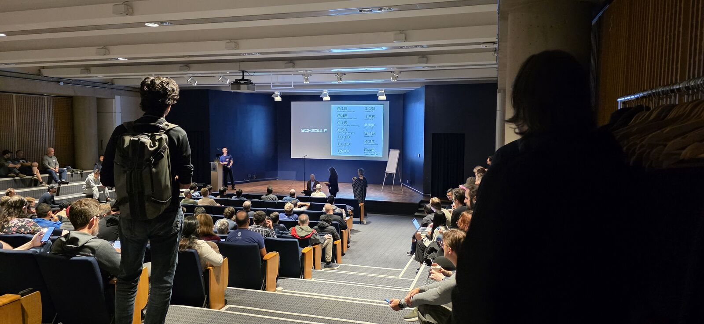
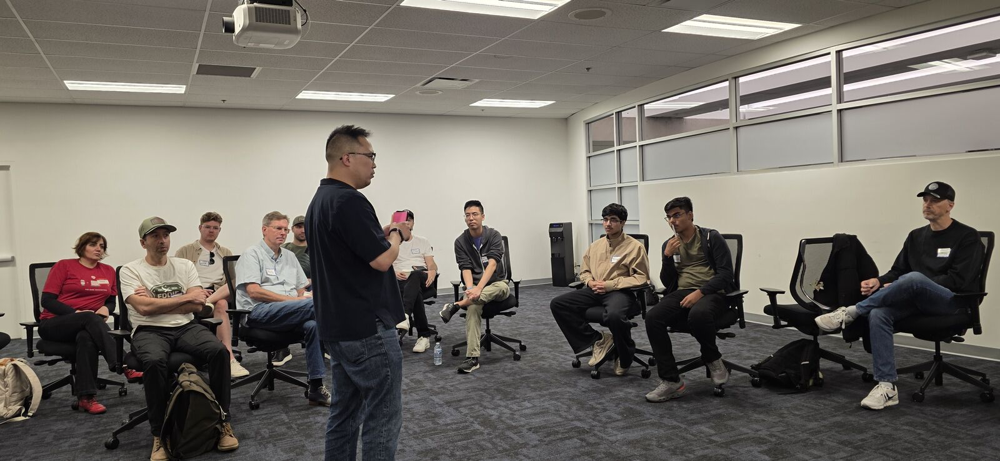
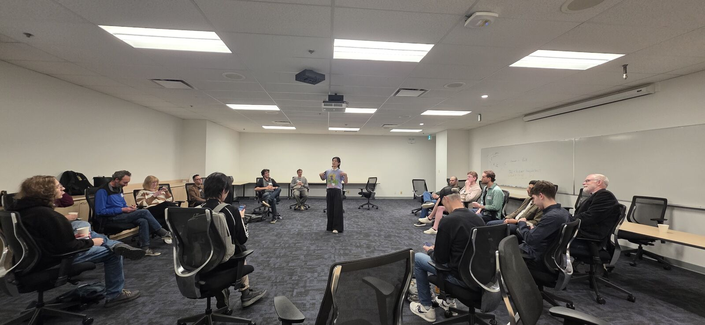
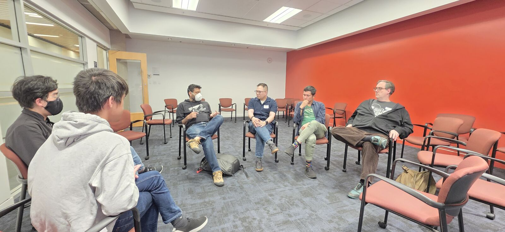
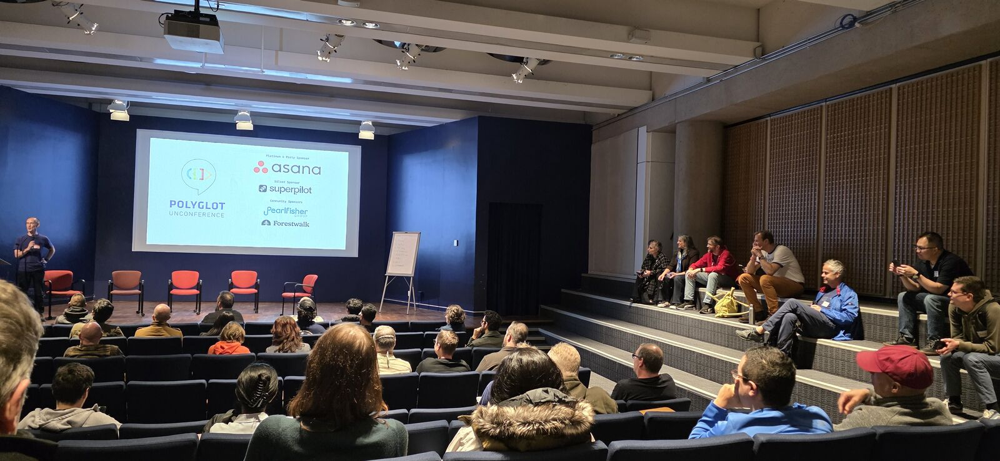

I attended the Polyglot Software Unconference in Vancouver on Saturday, October 17, 2026. This was my second time
attending. I posted my [recap of the first one](/posts/polyglot-unconference-2025-recap/) a year late, so this time I'm
trying to make it right by posting my recap sooner.

## Late arrival

I'm kind of embarrassed to admit that I arrived late. But I have a good excuse: the night before, my husband and I went
fishing at this beautiful lake. We didn't catch anything, but it was still worthwhile. We got back home really late, at
around 10 pm, so in the morning I overslept.

  
  

While I was still on the SkyTrain on my way to the venue, the pitching session started. The pitches went up on a live
website, so I could see the pitched sessions on my phone and follow along. Then I got a text from my friend Daniel Chen,
offering to submit a pitch on my behalf. At first I didn't have anything in mind. But as the pitches came in, I noticed
almost all of them were about AI. Since it seemed like there was a lot of interest in this topic, I realized I might
also want to bring up how to handle open source contributions in the age of AI.

Daniel said he had been planning to pitch the same topic, so he ended up putting both our names on it. It got picked,
and I made it just in time for the first session.

## How do we teach and assess knowledge in the age of AI?

_Pitched by Daniel_

This session brought together students, educators, and hiring managers, all wrestling with the same question from
different sides: how do you know what someone actually knows?

**Students** described the tension between learning slowly and letting AI rip to get lots done. If AI can do it all,
where do you draw the line? And GPA still matters, even when a high grade no longer proves you understand the material.

**Educators** said students now use words and ideas they don't understand. Papers are increasingly written with AI and
also assessed by AI, which brings its own bias. One educator pushed back on the idea that this is new: it's the same
problem as question banks and leaked past exams. Students who take the shortcut get the grade without the learning.
"Show your work" still applies, though teachers now use AI to verify that too.

How do you reward people who are willing to make mistakes and learn?

**Hiring managers** said that at a glance, every candidate now looks good. Some have shifted from asking candidates to
write code to asking them to explain code. The advice for junior developers was to treat learning as part of the job:
use AI as a tutor, not just a code producer, and be able to justify why it did what it did. For hiring managers, the
suggestion was to select for curiosity and a willingness to learn.

When students were asked how they want to be assessed, projects came up as fairer, since you can put in sustained work
over time. But that doesn't help when time is short. An educator also pointed out a deeper gap: extroverts are happy to
talk about their work, introverts often aren't, so oral assessment has its own bias.

### Reflection

I joined this session not because I'm in academia, but because we have a similar problem in open source, and in the
workplace when interviewing candidates: how do we assess someone's contributions or skills?

When I come to events like this, we chat among ourselves and share our AI workflows and our processes. That's how I come
to know that the people I meet are real humans, with opinions, experience, and skill. It gives me signals of their
credibility and authenticity.

But when an AI-generated PR comes from a new contributor, I can't know any of these things. That's what I've been
struggling with: how can I know, and what do I even want to know?

Is asking people how they use AI the solution? They might just say "I use Claude Opus", which isn't that useful to me. I
also don't think forbidding AI-generated contributions is the solution.

The only conclusion I have is that actually chatting with people at events like this one and hearing them talk about
their workflows is how I can form trust. But this doesn't scale, and it doesn't work for global open source projects
like CPython. So I still don't know what the solution is.

In the meantime, I think it's important to share and present our work, to show our knowledge of a topic, and to be
opinionated.

## Context switching across coding sessions

_Pitched by Roman_

One framing: we're becoming more like project managers. Instead of managing projects, we now manage agents.

Tools and tactics people shared included [herdr](https://github.com/herdrdev/herdr) (a new-to-me tool I learned about
here), self-documenting Makefiles, generating HTML for reporting, and [Television](https://television.run/).

One suggestion was to acknowledge that context switching is expensive and block time for it. Instead of switching, just
wait. Others leaned on workflows and automation: one agent writes the code, another reviews and critiques the PR, and a
third runs end-to-end (e2e) tests as part of CI.

How do you make sure your e2e tests are good? That's your job now. On UX and e2e testing, some found agents more
diligent than they themselves are: an agent will cover far more paths and edge cases than a human would bother to.

Who still does code review? Only a few people raised their hands. Several said they only look at the test files, not the
code. For some, code review is no longer about the code, but about asking the LLM to clarify.

Is it more costly for you to wait on the agent, or for the agent to wait on you? The answer from the room was to make
the agent wait on you. You have value, and for you to be valuable, you need to be present. That takes self-discipline.

The last suggestion was to bring back traditional time blocking, but for agents: allocate your own time for specific
work. Is Pomodoro still a thing? Apparently not anymore.

### Reflection

Television is the tool from this session that I adopted. If you read my Python core sprint posts, you may have noticed
that I installed it and used it the week after, to track the whole CPython bots migration. There are screenshots of it
in my [day 1](/posts/python-core-sprint-2026-day-1/) and [day 2](/posts/python-core-sprint-2026-day-2/) posts.

Agents may be more diligent at e2e testing, but a passing test doesn't mean the UX is any good. That's where human
judgement still matters. AI doesn't know what works for people, like a filter panel taking up half the screen. Those are
things only a human sees first.

## Shipping code is a coping mechanism

_Pitched by Germaine_

The provocation: do you really need to write a script and solve the problem, or do you just need reassurance?

When designing, always ask: what if we do nothing? What's the impact and the cost? If you wait, does it get better or
worse? Doing things that don't scale can be fine, but only if you understand the problem. AI helps here, since it makes
it cheap to create micro solutions.

Then came a disagreement. Someone said they were hired as an engineer to write code. Others, including me, disagreed.
Writing code is not the bulk of the job. We are hired to solve problems, to plan, to architect, and to think through
consequences and impact. Making sure you solve the business's problem is still what matters.

AI makes it easier for anyone to become a builder. But solving the right problem still comes with experience. Clients
often say they need X when that isn't what they really need. One technique shared was the "why stack": ask why, then ask
why about the answer, and keep going.

Someone described an all-hands where the question was whether non-engineers should ship code. They said that in their
opinion, the answer was always no. Their argument: non-engineers aren't necessarily strong systems thinkers. They see
the pain in front of them and can't see past it, and their fix might create second-order problems.

That sparked more questions. Accountants are problem solvers too. If the CEO pushes a vibe-coded app, who gets paged
when it goes down? Is the CEO wired to PagerDuty? The room was split. We're not responsible for balance sheets, so
should CEOs be responsible for software?

What hasn't changed with agentic coding? Teams. Teams are still the unit of responsibility. Someone suggested that
instead of simply saying no to the CEO, engineers should set boundaries: anyone shipping code still has to follow
engineering practices.

## Human leadership vs AI leadership

_Pitched by Jeremy, combined with related pitches on ramping early-career devs, mid-tier management in an AI coding
world, and sprint management with an AI SDLC_

I took a break from sessions and only caught part of this one, so my notes are light. The part I heard was about raising
the bar: an engineering manager's job is to raise the bar for everyone else.

## Governing AI contributions in open source

_Pitched by Daniel and me_

Our session was in the last slot of the day, and it was attended by both maintainers and open source contributors. The
contributors shared their experience contributing with AI, and wanted to know how they could help maintainers and what
maintainers want to see from them. The maintainers shared their experience receiving AI-based contributions. Together,
we talked about how we can all continue to collaborate.

One person said they use the [vouch](https://github.com/mitchellh/vouch) system for new contributors in their project.
That raised the question: are we gatekeeping?

One maintainer said the commit message is the bar. Their project has a commit message template, and contributions have
to follow it. So far, they felt LLMs aren't good enough to write commit messages to that standard. They'd rather have
fewer contributions than deal with the draining mental load of inconsiderate ones.

There was nuance, too. People who aren't fluent in English have long used tools, and now LLMs, to help them write. But
as maintainers, we want to help people and talk to people. Someone shared a new term for AI-written text nobody wants to
read: **ai;dr**.

We talked about how hard it is to trust new contributors now. Am I talking to a person, or am I just a proxy for
someone's LLM?

Do projects have written rules about AI usage? One maintainer argued the Code of Conduct matters more than ever, because
this is a conduct issue: LLMs are a new way to be rude to each other. Is an AI policy part of the CoC or the
contributing guide? The room's answer: yes, both.

As for existing policies, people mentioned liking the FSF's, though I didn't follow up on which policy exactly they
meant. Fedora's seemed OK, but not ideal.

### Reflection

I know how I use AI. I go through iterations, and I know my harnesses, limits, and guardrails. What I don't know is a
new contributor's workflow, and that makes it hard to trust them. It's the same problem I wrote about after the
[assessment session](#how-do-we-teach-and-assess-knowledge-in-the-age-of-ai): from an AI-generated PR, I can't tell what
someone knows.

That's also why, when a contributor in the session said they use AI because they're not a native English speaker, I said
I really prefer someone's basic English over AI word vomit.

I tried mentoring over the last year. Many contributors just wanted to open a PR and showed no interest in learning.
They couldn't address any of the issues I raised, and some didn't even know how to set up the local dev environment.

It also cuts the other way. Contributing to other people's projects is something I hesitate to do now, because I know
how maintainers feel and I want to respect that. I don't want to send AI-written code if it's against their policy.

Even for my own personal open source projects, I honestly don't really want PR contributions from others, for the same
reasons. So I still do open source, but it's become more "source available" than collaboration. I feel like I have less
trust and good faith than I used to, and I don't like that about myself.

AI contributions were also a hot topic at the Python core sprint the week after. The discussions there led to
[updated triage guidelines and process for CPython's AI policy](https://discuss.python.org/t/updated-triage-guidelines-and-process-for-our-ai-policy/109717).

I'm not fully comfortable with the vouch model. As I mentioned, I hate that I now start with less trust towards new
contributors, and I don't know if a mechanical process like vouching is the right solution. I'm still reflecting on
this. Even when discussing our AI enforcement policy with other core team members, it seemed like we kept trying to come
up with more process, more mechanics, and more criteria. Will any of these actually solve the problem?

And what if maintainers themselves are biased? How does this affect the diversity of contributors? It could favor
certain people: people with privilege, people who get to go to conferences and meet the maintainers, and people with
extra time to engage with maintainers. So I'm still uncomfortable that we're reaching for tools and bots first, as if
tooling alone could solve this.

Again, I don't know what to do about all of this yet. I'm still learning, and I don't consider myself an expert. That's
why I come to sessions like this: to learn from others.

## The unconference has changed

At the closing, someone asked whether the unconference topics have shifted. They have. There's a lot more AI now, and
far fewer of the managerial topics that used to dominate. In past years, many engineers had been promoted into people
management, so a lot of the sessions were about that.

[Last year](/posts/polyglot-unconference-2025-recap/), I attended a wide range of sessions that had nothing to do with
AI. This year, every session I went to was about AI. There were other topics too, like Unicode and fonts, functional
programming, and one titled "don't talk to me about AI: let's talk about film photography!"

Maybe that's my own bias. I found myself drawn to the AI sessions because I'm still struggling with the consequences and
trying to figure out the right thing to do. There are still a lot of aspects of AI that trouble me, but also a lot of
good things.

The thread running through every session I joined was the same: AI changes how work gets produced, but not who is
responsible for it. Students still need to learn, engineers still own the problems they solve, teams still carry the
pager, and maintainers still need to trust the people they work with.

Most of these conversations weren't technical in the usual sense. Nobody was arguing for one model over another. It
wasn't about the LLM itself. Even though the people in those rooms are highly technical and skilled, almost every
conversation I had was about people: how we learn, how we assess each other, how we take responsibility, and how we work
together.

That's why I value in-person events like this. When code is cheap to produce, what matters is knowing the humans behind
it. Sitting in a circle, hearing someone describe their workflow, their doubts, and their opinions is how I come to
trust them as real people with real experience. A pull request can't give me that.

We still want to collaborate with real people. That's what I meant earlier about the importance of talking about how we
work and sharing it openly. It's how we build the trust that AI-generated work can't. As AI keeps changing our work, I
think events like this unconference will be more relevant than ever.

## How I wrote this post

In the spirit of sharing how we work: this post started as my notes from the sessions. I don't use AI to record and
summarize for me, not for this unconference and not for other meetings or sessions either. Rather, I do it the
old-fashioned way: during the sessions, I open my laptop and type the things that caught my attention into a running
doc. I then completed the post with AI assistance. The first draft was ready on October 19, two days after the
unconference. It still took me another 11 days to publish, because I kept reviewing and editing it. After the first
draft, I went through nearly 40 rounds of edits, including three rounds of editorial review and fact-checking.
