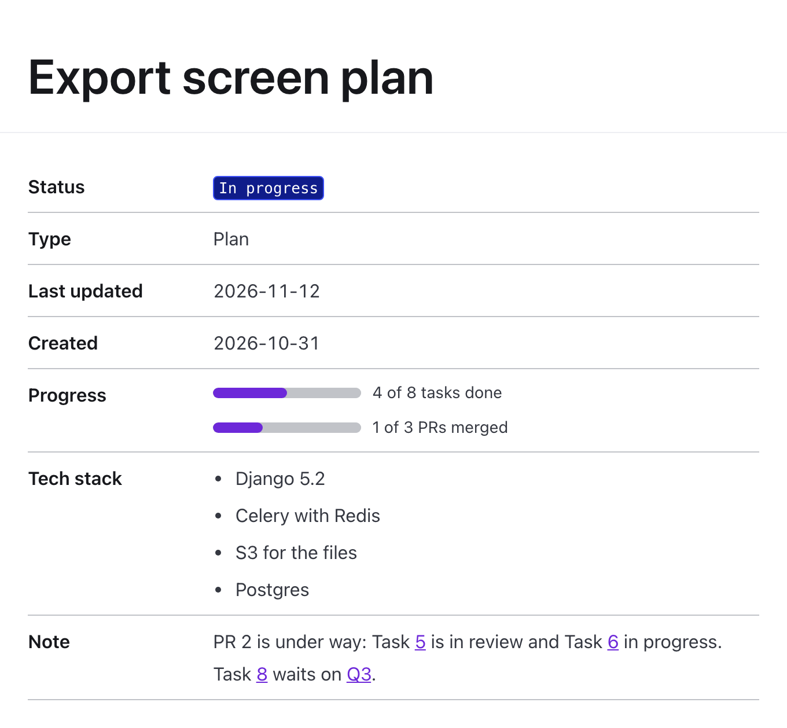
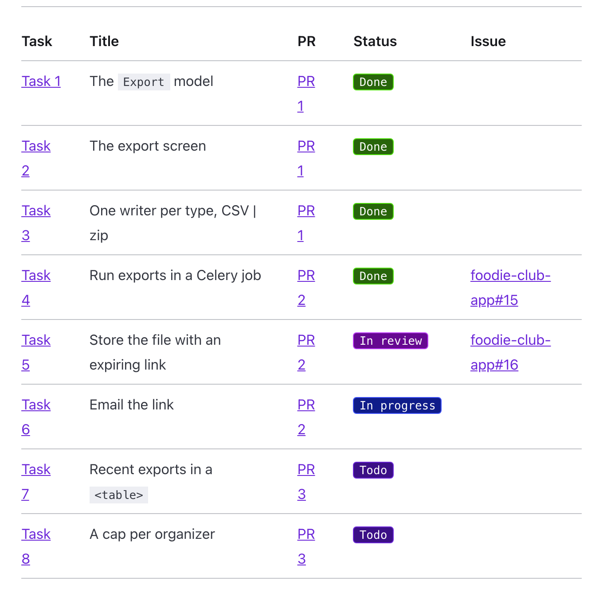
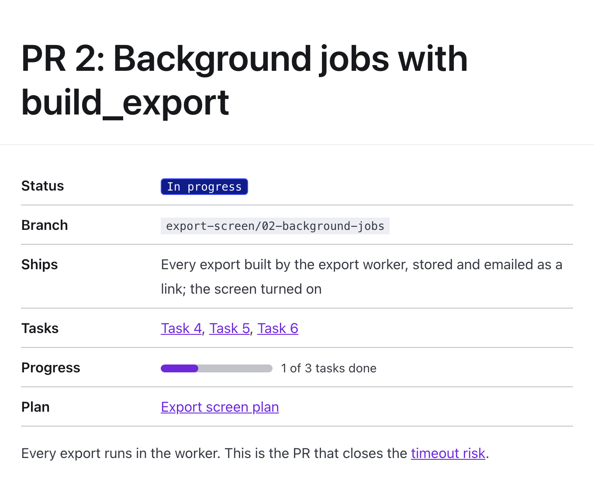
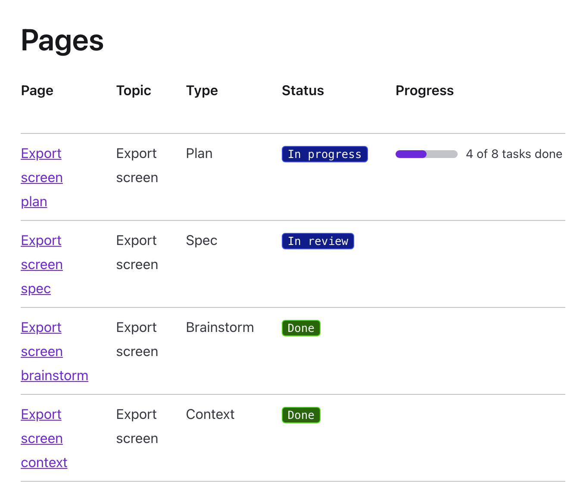
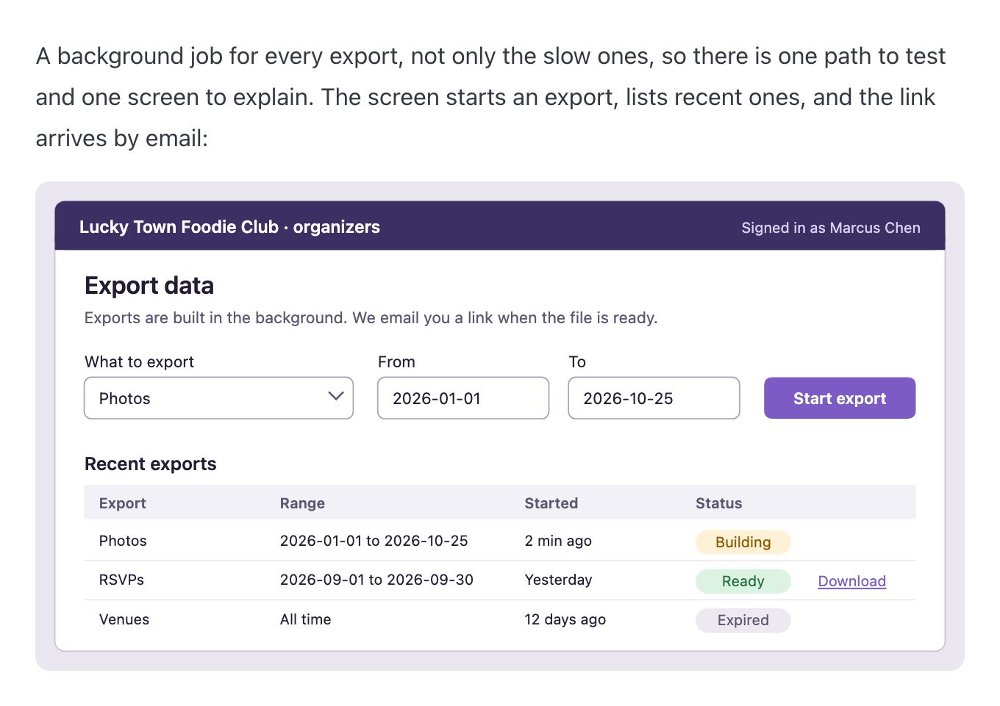
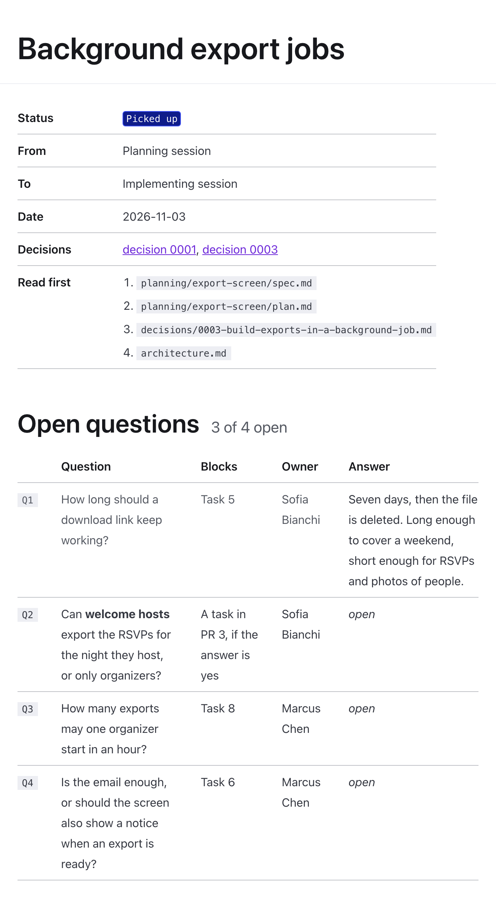

I'm happy to announce my new personal project: [Violet](https://mariatta.ca/starlight-violet/), which is a plugin for
[Starlight](https://starlight.astro.build/), Astro's documentation framework. Violet is for the notes that live beside
your code: plans, decisions, runbooks, and handoffs. It takes the Markdown files already sitting in your repo and turns
them into a documentation site you can actually read.

## What it does

Violet reads your notes folder in place. You don't move any files. On top of that it adds:

- **Page kinds.** Planning pages (context, brainstorm, spec, and plan), reference pages, decisions, and handoffs come
  built in, and you can define your own. Each kind has its own purpose, schema, and layout.
- **Front matter as data.** Fields like status, dates, issues, and related pages are validated at build time and shown
  as badges and tables in the page header. If something is missing, the build fails and tells you which file and which
  field.
- **Plans with tasks and PRs.** A plan lists its tasks and pull requests in front matter. Writing "Task 3" in the plan,
  or in another page in its folder, becomes a link to that task, and a long plan can be split into one page per PR.
- **Shortcodes.** One line like `::planning` or `::decisions` generates an index table from your notes, so it never goes
  stale.
- **A writing guide for agents.** More on this below.

Here's a plan from Violet's [example notes](https://mariatta.ca/starlight-violet/examples/), for an export screen in a
made-up club app. The header comes from front matter: the status badge, the dates, and progress bars for the tasks and
PRs.



The plan's tasks are in front matter too, each with its own status, its PR, and its issue.



Each PR in that plan also gets its own page, with its branch, what it ships, its tasks, and a link back to the plan.



All of that comes from one Markdown file. Here's a shortened version of the plan behind those pages:

```markdown
---
kind: planning
type: plan
split: true
status: in-progress
created: 2026-10-31
updated: 2026-11-12
stack:
  - "Django 5.2"
  - "Celery with Redis"
tasks:
  - { number: 1, status: done }
  - { number: 4, status: done, issue: "foodie-club-app#15" }
  - { number: 5, status: in-review, issue: "foodie-club-app#16" }
  - { number: 6, status: in-progress }
prs:
  - number: 2
    branch: export-screen/02-background-jobs
    tasks: [4, 5, 6]
    ships: "Every export built by the export worker, stored and emailed as a link"
    status: in-progress
---

# Export screen plan

Build the [spec](spec.md) in three pull requests. ...

::prs

::tasks

# PR 2: Background jobs with `build_export`

### Task 4: Run exports in a Celery job

`build_export(export_id)` loads the row, runs the writer from Task 3 ...
```

The front matter holds the status of every task and PR, `::prs` and `::tasks` turn it into the two tables, and
`split: true` makes each `# PR` heading its own page. You can read
[the full plan](https://github.com/mariatta/starlight-violet/blob/v0.3.0/docs/examples/planning/export-screen/plan.md)
on GitHub, and browse [all the example notes](https://mariatta.ca/starlight-violet/examples/) rendered on the docs site.

And this table comes from a single `::planning` line in a reference page. When a note's status changes, the table
changes with it.



## Why I built it

I'm still experimenting with how to work and code with AI agents more effectively.

Small tickets are easy. For a bug fix or a small change with a clear issue, I can hand the issue to an agent and review
the pull request it comes back with.

Bigger pieces of work are different. They need more architectural work and planning, and they need to be broken down
into smaller pieces before an agent starts writing the code. That takes several rounds. One session gathers context.
Another session is me brainstorming with the agent: weighing the pros and cons of each option, fleshing out the details,
bringing up questions, making decisions, and catching things that weren't obvious at the beginning. Only after the
design is settled does the plan get written, split into pull requests small enough to review, and handed to an agent to
implement.

All of that produces a lot of writing. Context reports, brainstorms, specs, plans, numbered decisions, reviews,
handoffs. Agents don't remember anything between sessions, and honestly, neither do I. I'm juggling several projects,
and a design can stretch over days or weeks. When I come back to something, I need to know where things stood, what was
decided and why, and what's still open.

So all of it goes into Markdown files in the repo. That part works. The agents can read the files, I can read the files,
and everything is versioned right alongside the code it describes.

But as the files piled up, I realized I needed a way to organize them. Not all notes are the same. A brainstorm is
exploratory and might be thrown away. A decision is something I committed to, and later work depends on it. A plan has
tasks and pull requests attached to it. A handoff is written for whoever picks up the work next. They have different
jobs, so they need different structure, and I wanted to tell them apart at a glance. I also wanted each note to carry
its own status, so I'd know whether something was still a draft, approved, or replaced by something newer, without
having to read the whole thing to find out.

By then, the folder had grown to hundreds of files. On GitHub, it's just a flat list of file names. Nothing tells me
which plan was approved, which decision is locked in, or which page is out of date. And decisions build on each other.
When I need to look up an earlier decision, why I made it, and what it replaced, scrolling through raw Markdown is
painful.

I started by rendering the notes as a site for one project. Then I realized I was using the same process across several
projects, and I wanted the same page types, the same front matter, and the same checks everywhere. A plan in one repo
should read like a plan in another, for me and for the agents. That became Violet.

## How did we do this before AI agents?

Planning and writing things down before building isn't new. What's new is how much of it there is now, and who's writing
it.

Before I started coding with AI agents, every project and every company I worked with did this differently.

Some had no docs at all. Whatever was decided lived in people's heads, or in a chat thread somewhere.

Some did their planning as a series of GitHub issues. Each issue had acceptance criteria and a deliverable, and that was
the plan.

Some used a combination of Confluence pages and Jira issues: the design in Confluence, the work tracked in Jira.

Some kept everything in Google Docs.

What these had in common is that they were all freeform. Each author wrote in their own style and decided for themselves
how much detail to include. Two design docs from the same team could look nothing alike.

Another thing they had in common: everyone had to work in the same tool. All the employees were in the same Confluence
space, or had access to the same Google Doc. That works fine for a company, where everyone gets the same accounts on
their first day. But what about personal projects? Or open source projects, where contributors come and go, and nobody
is going to sign up for your Confluence just to send a pull request?

And in all of these setups, I've seen many of the initial docs go stale. They described the plan at the start, and then
the project moved on without them, until they no longer matched the current state of the project. Now, I instruct my
agents to keep the docs up to date, and to reconcile them with what was actually implemented.

An interesting comparison is how large features get implemented in Core Python: through the PEP process. You can think
of a PEP as Python's feature planning doc. Someone proposes an idea and writes it up: what problem it solves, what it
will add or change, how it will be implemented, and what alternatives were considered. The draft is posted on the
[Discourse forum](https://discuss.python.org/), where the community and the core team discuss it. The author updates the
PEP based on that discussion, sometimes over several rounds, until it's ready for a decision.

PEPs are more structured than most planning docs. There's a template, required headers, and a status, so there's a clear
record of what was accepted, rejected, or superseded, and why. Each PEP is a reStructuredText file in the
[python/peps](https://github.com/python/peps) repo, and [peps.python.org](https://peps.python.org/) is built from those
files with Sphinx, using the repo's own Sphinx extension with a custom parser for PEPs. The build even fails on
reStructuredText warnings. That's probably part of why I wanted the same kind of structure for my own notes.

All of these are different ways to build software. Which one is right? Whichever works for you. For my own projects,
including open source ones where contributors come and go, I wanted something that didn't depend on everyone using the
same tool:

- **The notes are plain Markdown files in the repo.** Nobody needs an account or an app to read or edit them, and GitHub
  still renders each file on its own. The notes are versioned together with the code they describe, in the same pull
  request.
- **The site is just a view.** It reads the notes in place. Anyone who clones the repo can build it, and if I stop using
  Violet one day, the notes are still there and still readable, though some markup won't make sense anymore. A shortcode
  like `::planning` or a link like `:task[4]` shows up as literal text on GitHub, and in most other Markdown renderers.
- **The structure is checked.** Each kind of note has a schema, and the build fails when a note doesn't follow it. That
  matters more when an agent is doing most of the writing.

That's what Violet does.

## How to use it

You'll need Astro 7 and Starlight 0.42. Create a Starlight site next to your notes, then install Violet along with
Starlight 0.42, since the Starlight template now starts on a newer version:

```sh
npm create astro@latest -- --template starlight docs-site
cd docs-site
npm install @astrojs/starlight@~0.42.0 starlight-violet
```

Your repo ends up looking something like this:

```
repo/
├── docs/            # your notes (Markdown)
│   └── deploy.md
└── docs-site/       # Astro + Starlight site
    ├── astro.config.mjs
    └── src/
        └── content.config.ts
```

Add Violet to Starlight's plugins and point `notes` at your notes folder:

```js
import { defineConfig } from "astro/config";
import starlight from "@astrojs/starlight";
import violet from "starlight-violet";

export default defineConfig({
  integrations: [
    starlight({
      title: "Project notes",
      plugins: [
        violet({
          notes: "../docs",
          kinds: ["planning", "reference"],
        }),
      ],
    }),
  ],
});
```

Then read the notes into Starlight's `docs` collection, in `src/content.config.ts`:

```ts
import { defineCollection } from "astro:content";
import { notesLoader, notesSchema } from "starlight-violet/content";

export const collections = {
  docs: defineCollection({ loader: notesLoader(), schema: notesSchema() }),
};
```

Give each note a kind in its front matter:

```markdown
---
kind: reference
status: current
updated: 2026-11-11
---

# Deploying
```

Finally, run `npx astro dev` and open the site.

### Pointing your agent at it

These days, most of my notes are written by coding agents, so Violet ships with a writing guide inside the npm package.
The agent can read it straight from `node_modules` without the site running. I add something like this to the project's
`AGENTS.md` or `CLAUDE.md`:

```
Docs live in `docs/` and are rendered by the site in `docs-site/`. Before
writing or editing any file under `docs/`, read
`docs-site/node_modules/starlight-violet/pages/writing.md`, then the repo's
own additions in `docs-site/src/content/docs/writing.md`. Run `make build` in
`docs-site/` when done.
```

The agent writes the note, the build checks it, and if the front matter is wrong, the agent finds out right away instead
of me finding out three weeks later.

## Is this the right way to do things?

I don't know if Violet is the right way for everyone. It's what works for me right now, but I'm still figuring out how I
want to work with AI agents, and this may well change.

But it's definitely better than reading raw Markdown files on GitHub. Two things in particular made a difference for me.

**I can see images and mockups rendered next to the writing.** A design discussion often includes a mockup or a
screenshot. In a raw Markdown file, that's a link to an image I have to open separately. In Violet, the mockup sits
right there on the page, next to the discussion it belongs to.



**I can work with people who don't use the same coding agent as me.** If I'm using Claude and my collaborator is using
Codex, we can't hand each other a platform-specific artifact. So we both write the handoff to Markdown instead. A
handoff in Violet has fixed sections: Summary, Context, What is decided, What is open, First task, and Files. Open
questions live in front matter with IDs, so whoever picks it up next can answer them in place. It doesn't matter which
agent wrote it or which agent reads it. It's just a file in the repo.



## Why "Violet"?

Violet is named after "Violet", a song by Savage Garden.

## Why I'm sharing this

In my [Polyglot Unconference recap](/posts/polyglot-unconference-2026-recap/#reflection-2), I wrote about how hard it is
for me to trust a pull request when an LLM was used heavily to write it. From the PR alone, I can't tell what the
contributor knows, or whether they understand the code they're sending.

That's my own personal conflict, because I use AI too. I know how I use it: what I send is never the first output. I
don't know that about others, and when I send an AI-assisted PR, other maintainers don't know that about me either.

So this post is me showing mine. Violet is a tool, but it's also a picture of how I work with AI agents: how much
planning happens before any code gets written, which decisions I make, and how I keep track of all of it. I hope it
helps you understand how I do it, and maybe it'll encourage you to share how you do it too.

## Try it

Violet is free and open source. The docs are at [mariatta.ca/starlight-violet](https://mariatta.ca/starlight-violet/),
including [the example notes](https://mariatta.ca/starlight-violet/examples/) from this post, and the code is on
[GitHub](https://github.com/mariatta/starlight-violet). If you're also experimenting with how to keep track of what you
and your agents are doing, I'd love to hear how you're approaching it.

If Violet is useful to you, consider [sponsoring my work on GitHub](https://github.com/sponsors/Mariatta).
